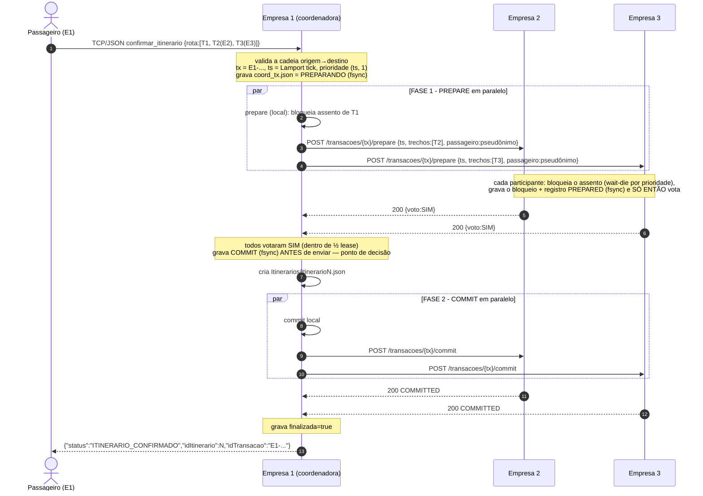
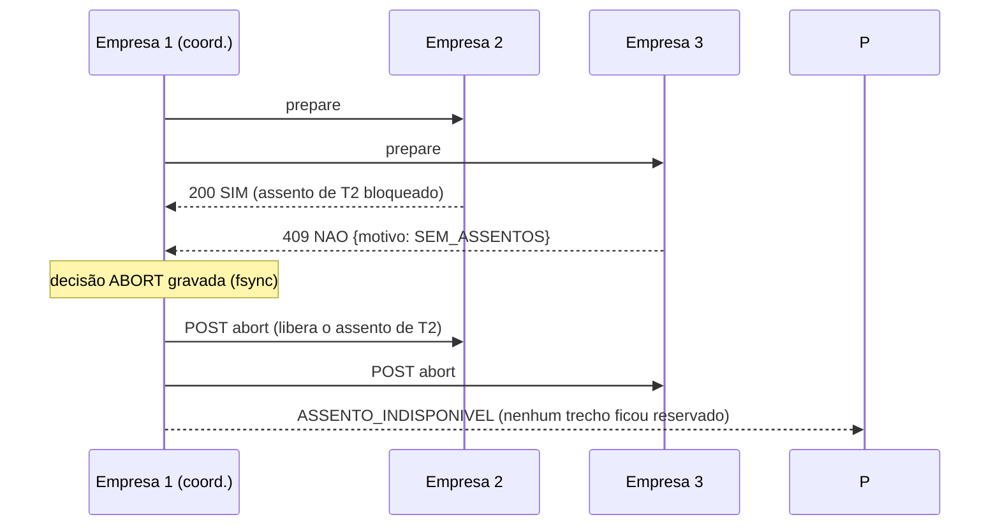
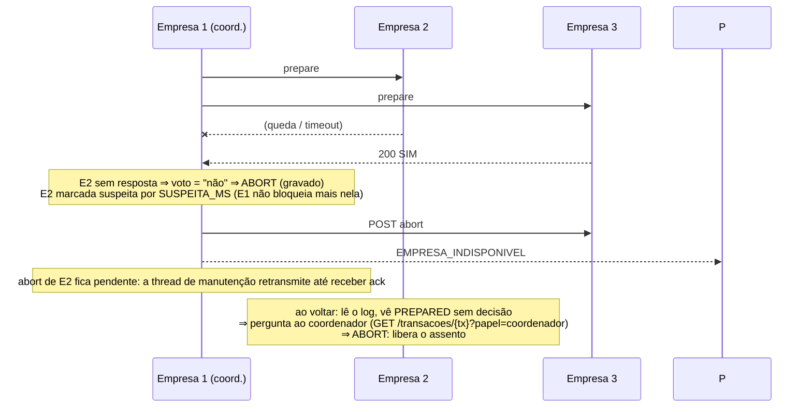

# VaiJunto — Consórcio de Caronas Compartilhadas (Problema 2, TEC502)

Cada empresa do consórcio executa o **seu próprio servidor** (contêiner Docker, armazenamento próprio). Passageiros e
motoristas falam só com o servidor da própria empresa (TCP + JSON, como no Problema 1); os servidores cooperam entre si
por uma **API REST** para que um passageiro monte itinerários com caronas de qualquer empresa e os confirme de forma
**atômica**, sem servidor central, coordenador fixo ou banco compartilhado.

| Requisito do enunciado | Como é atendido | Onde |
|---|---|---|
| Atomicidade entre empresas | Two-Phase Commit com **coordenador por transação** (a empresa do passageiro), log write-ahead com fsync | `consorcio.c` |
| Nenhum assento duplicado | Cada empresa é dona dos seus assentos; bloqueio sob mutex do trecho, durável e idempotente | `consorcio.c`, `servidor.c` |
| Precedência na disputa | Relógio lógico de **Lamport** persistido + prioridade `(ts, empresa)` + **wait-die** (sem deadlock) | `lamport.c`, `consorcio.c` |
| Falhas e recuperação | Log do coordenador/participante, recuperação na partida, terminação cooperativa, lease do voto SIM, retransmissão | `consorcio.c` |
| API REST entre servidores | libmicrohttpd, 10 endpoints, `X-Lamport-Clock` | `docs/API.md`, `consorcio.c` |
| Docker, uma empresa por contêiner | `DockerFile.Servidor`, `docker-compose.yml`, `docker-compose.empresa.yml` | raiz |
| Simulador de passageiros | `simulador/simulador.py` (carga concorrente sem GUI) | `simulador/` |
| Teste automatizado (carga + falhas) | `testes/teste_consorcio.py` (I1, I2, I3 + disponibilidade + controle negativo) | `testes/` |
| Relatório SBC | `relatorio/relatorio.tex` (+ PDF) | `relatorio/` |

# API REST entre os servidores do consórcio VaiJunto (v1)

Cada empresa executa o seu próprio servidor (contêiner Docker, armazenamento próprio) e expõe, além da porta dos
clientes (TCP/JSON, `65432`), uma **API REST/HTTP na porta `8080`**. É por essa API — HTTP simples, que atravessa
firewalls — que as empresas cooperam. Não há servidor central, coordenador fixo nem banco compartilhado.

- Base: `http://<host-da-empresa>:8080/api/v1`
- Formato: JSON UTF-8 (`Content-Type: application/json; charset=utf-8`). Cada resposta fecha a conexão.
- Quem chama: **apenas outros servidores do consórcio**. Passageiros e motoristas falam só com o servidor da própria empresa.

## 1. Convenções

| Item | Regra |
|---|---|
| **Relógio de Lamport** | Toda requisição e resposta leva `X-Lamport-Clock: <inteiro>`. Ao **enviar**: `C = C + 1` e o valor vai no cabeçalho. Ao **receber**: `C = max(C, C_msg) + 1`. O relógio é persistido (marca d'água em disco) e nunca volta atrás após uma queda. |
| **`X-Empresa-Id`** | Presente nas respostas: id da empresa que respondeu. |
| **Id global de trecho** | O passageiro vê `id = empresaId × 1 000 000 + idLocal` para trechos de **outras** empresas. Ids `< 1 000 000` são da própria empresa. Na API REST entre servidores o trecho é sempre o **id local** (`0 ≤ idTrecho < 1 000 000`) da empresa dona. |
| **Id da transação** | `E<empresaCoordenadora>-<ms>-<seq>` (ex.: `E1-1a15b13430b-0`). Só `[A-Za-z0-9_-]`, 3 a 64 caracteres (validado: o id vira nome de arquivo). A empresa coordenadora é deduzida do prefixo. |
| **Prioridade** | `(ts, empresa)`, onde `ts` é o timestamp de Lamport obtido pelo coordenador ao iniciar a transação e `empresa` desempata. Menor = mais antiga = precedência. |
| **Privacidade** | O e-mail do passageiro **nunca sai** da empresa dele: para outras empresas vai um pseudônimo `p<empresa>-<hash64>`. |
| **Idempotência** | Todas as operações de transação podem ser repetidas (mensagens duplicadas/atrasadas/reordenadas): repetir `prepare`, `commit`, `abort` ou `cancelar` devolve o mesmo resultado sem efeitos extras. |
| **Detecção de falhas** | Timeouts de conexão/resposta. Um par que não responde é marcado *suspeito* por `SUSPEITA_MS` e tratado como fora do ar (sem bloquear as demais empresas). |
| **Erros** | Corpo `{"erro":"CODIGO","mensagem":"texto"}`. |

## 2. Recursos

### 2.1 `GET /health`
Verifica se a empresa está viva. **200** → `{"status":"ok","empresaId":2,"api":"v1","lamport":57}`

### 2.2 `GET /trechos`
Lista as caronas **da empresa** (cada empresa é a única responsável pelos seus assentos).

Query (todas opcionais): `origem`, `destino` (sem diferenciar maiúsculas), `data` (`dd/mm/aaaa`), `disponiveis=true`
(só com `capacidade > 0`), `auditoria=1` (só efetivo com o servidor em `MODO_TESTE=1`).

**200** → array:
```json
[{"empresaId":2,"idTrecho":0,"nomeMotorista":"Motorista2","origem":"Simoes_Filho","destino":"Feira_de_Santana",
  "data":"27/10/2026","hora":"23:00","capacidade":24,"capacidadeTotal":25,"preco":25}]
```
`capacidade` = assentos **livres** agora (descontados bloqueios de transações em andamento). Com `auditoria=1` em
`MODO_TESTE`: `clientes` (nº de reservas), `reservas:[{tx,id}]`, `bloqueios:[tx]`, `passageiros:[id]`.

### 2.3 `GET /trechos/{idLocal}`
**200** trecho (mesmo formato) · **400** `ID_INVALIDO` · **404** `TRECHO_NAO_ENCONTRADO`.

### 2.4 `POST /transacoes/{tx}/prepare` — fase 1 do 2PC (coordenador → participante)
Pede que a empresa **bloqueie** um assento em cada trecho listado e vote. Corpo:
```json
{"coordenador":1,
 "ts":{"lamport":42,"empresa":1},
 "leaseMs":30000,
 "participantes":[1,2,3],
 "passageiro":{"id":"p1-43d37e421ded0248","nome":"Ana"},
 "trechos":[{"idTrecho":0,"origem":"Simoes_Filho","destino":"Feira_de_Santana"}]}
```
| Status | Corpo | Significado |
|---|---|---|
| **200** | `{"voto":"SIM","trechos":[<trecho>...]}` | Assentos bloqueados **e** voto gravado em disco (fsync) antes de responder. Repetições devolvem o mesmo SIM. |
| **409** | `{"voto":"NAO","motivo":"..."}` | Voto NÃO. Motivos: `SEM_ASSENTOS`, `CONFLITO_PRECEDENCIA`, `TIMEOUT_CONFLITO`, `RESERVA_DUPLICADA`, `TRECHO_NAO_ENCONTRADO`, `TRECHO_INCOMPATIVEL` (origem/destino não conferem), `TX_ABORTADA` (o ABORT chegou antes), `EM_ANDAMENTO`, `ERRO_PERSISTENCIA`. |
| **400** | `{"erro":"REQUISICAO_INVALIDA"}` ou `JSON_INVALIDO` | Corpo inválido (até 16 trechos, ids sem repetição). |
| **413** | `CORPO_MUITO_GRANDE` | Corpo acima de 64 KiB. |

`leaseMs` é o prazo do voto SIM (ver §4.4). `0` = 2PC estrito.

### 2.5 `POST /transacoes/{tx}/commit` — fase 2 (decisão COMMIT)
Converte os bloqueios em reservas definitivas. Corpo `{}`.
**200** `{"txId":..,"estado":"COMMITTED"}` (inclusive se já estava) · **404** `TRANSACAO_DESCONHECIDA` · **409** `ESTADO_INVALIDO` (a empresa já **abortou** por timeout — o coordenador então compensa, §4.4).

### 2.6 `POST /transacoes/{tx}/abort` — fase 2 (decisão ABORT)
Libera os bloqueios. Corpo `{}`. **200** `{"txId":..,"estado":"ABORTED"}` (também para transação desconhecida: grava um
*tombstone* que faz um PREPARE atrasado receber NÃO) · **409** `TRANSACAO_JA_CONFIRMADA`.

### 2.7 `POST /transacoes/{tx}/cancelar` — compensação
Desfaz a transação em **qualquer** estado, inclusive já `COMMITTED`. Só o coordenador a usa, e apenas quando outro
participante abortou por lease e o COMMIT decidido não vale mais em todas as empresas. **200** `{"txId":..,"estado":"ABORTED"}`.

### 2.8 `POST /transacoes/{tx}/terminacao` — terminação cooperativa (participante → participante)
Pergunta o estado local da transação a outra empresa participante. **200** `{"txId":..,"estado":"PREPARED|COMMITTED|ABORTED|..."}`.
Se a empresa consultada **não conhece** a transação, ela grava ABORTED e passa a **nunca mais votar SIM** nela.

### 2.9 `GET /transacoes/{tx}?papel=coordenador|participante`
- `papel=coordenador` (só na empresa coordenadora): **200**
  `{"txId":..,"papel":"coordenador","decisao":"COMMIT|ABORT|PENDENTE","finalizada":true,"trechos":[{"empresaId":2,"idTrecho":0}]}`.
  Sem registro ⇒ `{"decisao":"ABORT","presumida":true}` (*presumed abort*). **404** `NAO_E_COORDENADOR`.
- `papel=participante`: **200** `{"txId":..,"papel":"participante","estado":"PREPARED|COMMITTED|ABORTED|DESCONHECIDA"}`.

### 2.10 Códigos gerais
`400` requisição inválida · `404` recurso/rota inexistente (`ROTA_NAO_ENCONTRADA`) · `409` conflito de estado/voto NÃO ·
`413` corpo grande · `5xx` falha interna (o coordenador trata como "sem resposta").

## 3. Diagrama de sequência — itinerário com trechos de três empresas

Passageiro da **Empresa 1** confirma `Salvador → Simoes_Filho` (E1) + `Simoes_Filho → Feira` (E2) + `Feira → Serrinha` (E3).
A Empresa 1 é a **coordenadora desta transação** (e só desta).



### 3.1 Variante: um participante vota NÃO (atomicidade)



### 3.2 Variante: uma empresa cai no meio



## 4. Garantias e como o protocolo as entrega

### 4.1 Atomicidade (Two-Phase Commit com **coordenador por transação**)
O coordenador é a empresa à qual o passageiro está conectado, **somente para aquela transação**. Não existe
coordenador fixo: três empresas coordenam transações diferentes ao mesmo tempo. Regras de durabilidade:
1. a decisão (COMMIT/ABORT) é gravada com `fsync` **antes** de ser enviada;
2. o voto SIM só é enviado **depois** de o participante gravar bloqueio e `PREPARED` (write-ahead);
3. a mudança de estado é gravada **antes** de aplicada ao trecho, então a recuperação sempre consegue refazer ou desfazer;
4. sem registro de decisão no coordenador ⇒ *presumed abort*.

### 4.2 Nenhum assento duplicado (exclusão mútua)
Cada empresa é a **única** dona dos assentos das suas caronas e os altera sob o mutex do trecho. O bloqueio do
assento (decremento de `capacidade` + registro em `bloqueios`) é uma seção crítica local e durável; `PREPARE` repetido é
idempotente; o mesmo passageiro não reserva duas vezes o mesmo trecho (`RESERVA_DUPLICADA`). Vários trechos de
uma empresa são bloqueados em ordem crescente de id (sem *deadlock* local).

### 4.3 Precedência na disputa do último assento (Lamport + wait-die)
Relógios físicos não são confiáveis nem sincronizados, então a precedência usa o **relógio lógico de Lamport**:
se *a → b* então `C(a) < C(b)`, independentemente de atrasos. A prioridade total é `(ts, empresa)`.
Quando uma transação quer um assento que está bloqueado por outra:
- a mais **velha** (menor prioridade) **espera** (até `ESPERA_CONFLITO_MS`);
- a mais **nova** **morre** (voto NÃO `CONFLITO_PRECEDENCIA`) — esquema *wait-die*, que **impede deadlock distribuído**,
  pois só se espera por transações mais novas, e a relação "mais velha que" é uma ordem total sem ciclos;
- se a capacidade ainda não acabou mas há uma transação mais velha esperando pelo mesmo trecho, as mais novas não furam a fila.
Assim o critério é bem definido, justificado e igual em todas as empresas.

### 4.4 Falhas e recuperação (nenhum bloqueio indefinido)
- **Participante cai com PREPARED gravado**: ao voltar, mantém o assento bloqueado e resolve a dúvida perguntando ao
  coordenador; se este não responde, usa a **terminação cooperativa** (`/terminacao`) com os outros participantes.
- **Coordenador cai antes da decisão**: na volta, `PREPARANDO` vira ABORT; participantes em dúvida consultam e abortam.
- **Coordenador cai depois da decisão**: na volta, retransmite a decisão aos participantes sem `ack`.
- **Bloqueio órfão** (queda entre bloquear e gravar PREPARED — o SIM nunca foi enviado): liberado na recuperação.
- **Lease do voto SIM** (`leaseMs`, padrão 30 s): se coordenador e demais participantes ficarem inacessíveis, o participante
  **aborta sozinho** ao fim do lease, liberando o assento (nenhum bloqueio é indefinido). Para que isso seja seguro, o
  coordenador só decide COMMIT se a votação terminou em **menos da metade do lease**; no caso extremo de um COMMIT recusado
  (`409`) por quem já abortou, o coordenador **compensa** (`/cancelar`) todos os outros e informa falha ao passageiro.
- **Demais empresas seguem operando**: o par fora do ar é marcado suspeito; buscas o ignoram e itinerários que não
  dependem dele são confirmados normalmente. Itinerários que dependem dele recebem `EMPRESA_INDISPONIVEL`.

## 5. Máquina de estados do participante

```
(nada) --prepare ok--> PREPARANDO --grava PREPARED--> PREPARED --commit--> COMMITTED
                          |  voto NAO / abort                     |--abort/timeout--> ABORTED
                          +-----------------------------> ABORTED (tombstone: PREPARE tardio recebe NAO)
COMMITTED --cancelar (compensação)--> ABORTED
```

## 6. Protocolo dos clientes (TCP + JSON), resumo

Inalterado em relação ao Problema 1 para cadastro, login e cadastro de caronas. O que o consórcio acrescenta:

| Ação | Requisição | Resposta |
|---|---|---|
| `buscar_carona` | `{"classe":"Cliente","acao":"buscar_carona","origem","destino","data"}` | array de trechos diretos de **todas** as empresas, cada um com `id`, `empresaId`, `nomeMotorista`, `origem`, `destino`, `data`, `hora`, `capacidade`, `preco` |
| `buscar_trechos_partida` | `{"acao":"buscar_trechos_partida","origem"}` | idem, para montar o itinerário trecho a trecho |
| `buscar_rotas` | `{"acao":"buscar_rotas","origem","destino","data"?}` | `[{"trechos":[{id,empresaId,origem,destino,nomeMotorista,data,hora,preco},...]},...]` — itinerários (até 6 trechos, 200 rotas) que misturam empresas |
| `confirmar_itinerario` | `{"acao":"confirmar_itinerario","emailCliente","nomeCliente","origemRota","destinoRota","rota":[{"idTrecho","origem","destino"},...]}` | `{"status":"ITINERARIO_CONFIRMADO","idItinerario":N,"idTransacao":"E1-..."}` ou texto: `ITINERARIO_INVALIDO`, `TRECHO_NAO_ENCONTRADO`, `ASSENTO_INDISPONIVEL`, `RESERVA_DUPLICADA`, `EMPRESA_INDISPONIVEL`, `FALHA_ITINERARIO` |


## Estrutura do repositório

```
cJSON/                 cJSON.c cJSON.h
GrafoMapa/             grafomapa.c grafomapa.h mapa.txt          (mapa + busca de itinerários)
DockerFile/            DockerFile.Servidor  DockerFile.Cliente  DockerFile.Motorista
src/                   cliente.c motorista.c formatos.h          (clientes do Problema 1)
src/Consórcio/         servidor.c servidor.h consorcio.c consorcio.h lamport.c lamport.h
docker-compose.yml     3 empresas na mesma máquina          docker-compose.empresa.yml  1 empresa por computador
docs/API.md            especificação da API REST + diagramas de sequência
simulador/             vaijunto.py (biblioteca), simulador.py (gerador de carga)
testes/                teste_consorcio.py (carga + injeção de falhas + auditoria)
relatorio/             relatorio.tex, refs.bib, sbc-template.sty, sbc.bst, relatorio.pdf
```

O **contexto de build do Docker é a raiz do repositório** (os `COPY` usam `cJSON/`, `GrafoMapa/` e `src/`). Dentro da imagem a pasta
`Consórcio` vira `consorcio` (sem acento) para evitar problemas de codificação de nomes de arquivo.

## Atalhos com o Makefile (na raiz do repositório)
```bash
make deps                  # instala gcc, libmicrohttpd, python3, curl (e GTK3 para a interface)
make                       # compila bin/servidor, bin/cliente, bin/motorista
make cluster-up            # 3 empresas locais em segundo plano (clientes :17001-17003, REST :18001-18003)
make cluster-kill EMPRESA=2   # derruba a empresa 2 (kill -9)      make cluster-start EMPRESA=2   # religa (recupera do disco)
make cluster-status | cluster-logs | cluster-down
make simulador DURACAO=30 THREADS=24   # carga + auditoria no cluster local
make teste                 # teste automatizado completo (modo local)
make docker-up | docker-kill EMPRESA=2 | docker-start EMPRESA=2 | docker-down | teste-docker
make relatorio             # compila o relatório SBC
```
Os clientes (`make run-cliente`) usam a porta fixa 65432: para usá-los com o cluster local, use `make run-servidor`
(empresa na porta padrão) ou o Docker (`docker compose run --rm cliente`, host `empresa1`).

## Executando

### A. Três empresas na mesma máquina (desenvolvimento)
```bash
docker compose up -d --build            # (na raiz do repositório) empresa1:65431/8081  empresa2:65432/8082  empresa3:65433/8083
docker compose run --rm motorista       # IP do servidor: empresa1  -> cadastre-se e publique caronas
docker compose run --rm cliente         # IP do servidor: empresa1  -> busque e confirme itinerários
docker compose kill empresa2            # derruba uma empresa; as outras continuam
docker compose start empresa2           # ela volta e se recupera sozinha
```

### B. Apresentação: uma empresa por computador do laboratório
Em cada máquina (ajuste os IPs; libere `65432/tcp` e `8080/tcp` no firewall):
```bash
EMPRESA_ID=1 PEERS="2=http://IP2:8080,3=http://IP3:8080" docker compose -f docker-compose.empresa.yml up -d --build
EMPRESA_ID=2 PEERS="1=http://IP1:8080,3=http://IP3:8080" docker compose -f docker-compose.empresa.yml up -d --build
EMPRESA_ID=3 PEERS="1=http://IP1:8080,2=http://IP2:8080" docker compose -f docker-compose.empresa.yml up -d --build
```
O tutor pode interromper qualquer uma (`docker kill empresaN`); religue com `docker start empresaN` (o volume preserva o disco).

### C. Sem Docker (compilação local, a partir da raiz do repositório)
```bash
sudo apt-get install -y libmicrohttpd-dev
gcc -O2 -Wall -I cJSON -I GrafoMapa -I src -I "src/Consórcio" -o servidor_bin \
    "src/Consórcio/servidor.c" "src/Consórcio/consorcio.c" "src/Consórcio/lamport.c" GrafoMapa/grafomapa.c cJSON/cJSON.c \
    -lmicrohttpd -pthread
gcc -Wall -I cJSON -I src -o cliente_bin   src/cliente.c   cJSON/cJSON.c
gcc -Wall -I cJSON -I src -o motorista_bin src/motorista.c cJSON/cJSON.c
# o servidor lê "mapa.txt" do diretório corrente:
mkdir -p /tmp/empresa1 && cp GrafoMapa/mapa.txt /tmp/empresa1 && cd /tmp/empresa1
EMPRESA_ID=1 PORTA_CLIENTES=17001 PORTA_REST=18001 PEERS="2=http://127.0.0.1:18002,3=http://127.0.0.1:18003" /caminho/para/servidor_bin
```

### Variáveis de ambiente do servidor
| Variável | Padrão | Significado |
|---|---|---|
| `EMPRESA_ID` | 1 | id da empresa (≥ 1, único no consórcio) |
| `PEERS` | vazio | `id=http://host:porta,...` das **outras** empresas |
| `PORTA_CLIENTES` / `PORTA_REST` | 65432 / 8080 | portas TCP dos clientes e HTTP entre empresas |
| `PREPARE_TIMEOUT_MS` / `DECISAO_TIMEOUT_MS` / `BUSCA_TIMEOUT_MS` | 5000 / 2000 / 1500 | timeouts de rede (detector de falhas) |
| `SUSPEITA_MS` | 3000 | tempo em que um par que falhou é tratado como fora do ar |
| `ESPERA_CONFLITO_MS` | 1500 | quanto uma transação mais velha espera por um assento disputado (wait-die) |
| `INDOUBT_MS` / `PREPARED_TIMEOUT_MS` | 3000 / 30000 | quando o participante começa a perguntar o resultado / lease do voto SIM |
| `MODO_TESTE` | 0 | 1 = expõe campos de auditoria na API (só para o teste automatizado) |
| `CRASH_AT` | — | falha injetada: `part_apos_prepare`, `part_antes_commit`, `coord_antes_decisao`, `coord_apos_decisao` |

## Simulador de passageiros
```bash
python3 simulador/simulador.py \
  --empresas 1=localhost:65431:8081,2=localhost:65432:8082,3=localhost:65433:8083 \
  --semear --threads 32 --duracao 30 --passageiros-por-empresa 40 --auditar
```
Em computadores diferentes: `--empresas 1=IP1:65432:8080,2=IP2:65432:8080,3=IP3:65432:8080`.
`--auditar` exige servidores com `MODO_TESTE=1`. Só usa a biblioteca padrão do Python 3.

## Teste automatizado (carga + injeção de falhas)
```bash
# sem Docker (3 processos, cada um com disco próprio) — precisa do binário compilado (opção C)
python3 testes/teste_consorcio.py --modo local --binario ./servidor_bin
# com Docker (usa o docker-compose.yml; derruba com `docker kill`)
python3 testes/teste_consorcio.py --modo docker
# subconjuntos
python3 testes/teste_consorcio.py --cenarios carga,queda --duracao 20
```
Verifica, lendo o estado de todas as empresas pela API REST:

- **I1** nenhum assento confirmado para dois passageiros (reservas ≤ assentos, sem passageiro repetido, `livres + reservados + bloqueados = total`);
- **I2** nenhum itinerário pela metade (toda transação com reserva foi decidida COMMIT e está reservada em **todos** os seus trechos; todo itinerário confirmado ao passageiro idem);
- **I3** nenhum assento bloqueado depois da queda e da recuperação;
- **D** com a empresa 2 fora do ar, itinerários E1+E3 continuam sendo confirmados.

Cenários: carga pura · `kill -9` da empresa 2 no meio da carga · falha injetada em 4 pontos críticos do 2PC · **controle
negativo** (corrompe um itinerário de propósito e exige que a auditoria o detecte). Código de saída 0 = tudo OK.

## Mudanças em relação aos arquivos originais
- `DockerFile/DockerFile.Servidor`: compilava só `servidor.c cJSON.c grafomapa.c` (o link falhava) e não instalava `libmicrohttpd`;
  agora compila `servidor.c consorcio.c lamport.c grafomapa.c cJSON.c` com `-I` para as pastas, instala as dependências, expõe a
  porta REST, guarda o estado em volume e traz healthcheck. `DockerFile.Cliente` e `DockerFile.Motorista` foram adaptados às pastas.
- `GrafoMapa/grafomapa.c/.h`: `buscar_rotas` só lia os trechos **locais**; agora usa `listarTrechosConsorcio()` e devolve itinerários
  que misturam empresas, com `id` global, `empresaId`, `data`, `hora` e `preco` (limite de 6 trechos / 200 rotas). Passou a incluir
  `consorcio.h` (por isso a compilação precisa de `-I "src/Consórcio"`).
- `src/Consórcio/servidor.c`: `fsync` na gravação dos trechos (durabilidade).
- `src/cliente.c`: leitura das respostas com buffer dinâmico (`realloc`), mensagem para `EMPRESA_INDISPONIVEL` e correção do login
  (resposta truncada com nomes longos).
- Novos: `docker-compose.yml`, `docker-compose.empresa.yml`, `docs/API.md`, `simulador/`, `testes/`, `relatorio/`.
