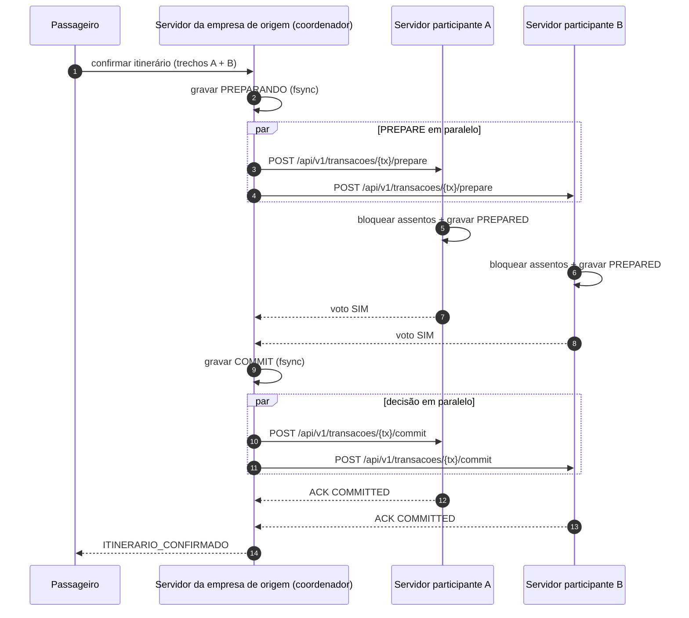
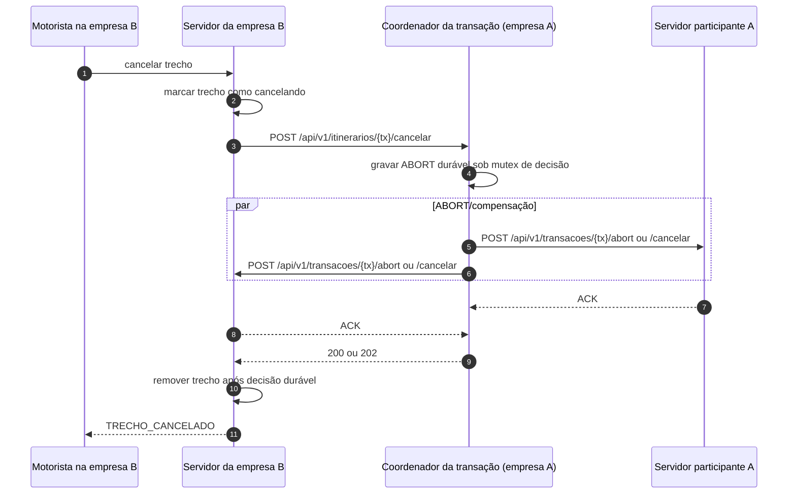

# VaiJunto — Consórcio de Caronas Compartilhadas

**Problema 2 — TEC502 | MI - Concorrência e Conectividade**

Este README reúne a documentação operacional e técnica do repositório: arquitetura, instalação, compilação, API REST entre empresas, busca distribuída, exclusão mútua, precedência, prevenção de deadlock, atomicidade, cancelamento, tolerância a falhas, persistência, testes e emulação Docker.

---

## 1. Visão geral

O VaiJunto permite que um passageiro cadastrado em uma empresa do consórcio monte e confirme um itinerário com caronas publicadas por empresas diferentes. Cada empresa executa seu próprio servidor, mantém seus próprios dados e é a única responsável pelos assentos das caronas que publicou.

- Passageiros e motoristas conectam-se **somente ao servidor da própria empresa**, pelo protocolo TCP/JSON reaproveitado do Problema 1.
- Os servidores das empresas cooperam por uma **API REST HTTP/1.1 com JSON**.
- Não existe servidor central fixo, banco de dados compartilhado ou armazenamento comum entre as empresas.
- O servidor do passageiro coordena somente a transação iniciada por aquele passageiro. Outra transação pode ter outro coordenador.
- A confirmação de um itinerário multiempresa usa **Two-Phase Commit (2PC)**; ou todos os trechos são confirmados ou a transação é abortada/compensada.

### 1.1 Requisitos e mecanismos

| Requisito | Mecanismo adotado | Implementação principal |
|---|---|---|
| Atomicidade entre empresas | Two-Phase Commit, coordenador por transação e log durável | `src/Consorcio/consorcio.c` |
| Não vender o mesmo assento duas vezes | Bloqueio local dos assentos sob mutex e registro persistente | `src/Consorcio/consorcio.c`, `servidor.c` |
| Precedência sem relógios sincronizados | Relógios lógicos de Lamport e prioridade `(timestamp, empresa)` | `lamport.c`, `consorcio.c` |
| Evitar deadlock | Aquisição ordenada e política wait-die | `consorcio.c` |
| Tolerância a falhas | Timeouts, suspeita temporária, lease, consulta cooperativa e retransmissão | `consorcio.c` |
| Recuperação | Logs de coordenador/participante e reaplicação idempotente | `consorcio.c` |
| Busca entre empresas | Consulta REST em tempo real aos pares | `consorcio.c`, `GrafoMapa/grafomapa.c` |
| Emulação | Docker Compose com três empresas ou uma empresa por computador | `docker-compose*.yml` |
| Carga e auditoria | Simulador e testes automatizados | `simulador/`, `testes/` |

## 2. Arquitetura

### 2.1 Componentes

Cada instância de empresa executa:

1. **Servidor de clientes:** atende passageiros e motoristas locais via TCP/JSON.
2. **Catálogo local de caronas:** mantém os trechos publicados por motoristas daquela empresa.
3. **Grafo de rotas:** combina trechos locais e remotos para formar itinerários entre origem e destino.
4. **API REST do consórcio:** expõe saúde, catálogo, operações de transação, consulta de estado e cancelamento.
5. **Coordenador 2PC:** servidor da empresa de origem do passageiro; registra a transação, envia PREPARE, decide COMMIT/ABORT e retransmite decisões pendentes.
6. **Participante 2PC:** servidor proprietário de um ou mais trechos; bloqueia os assentos locais, persiste o voto e aplica a decisão do coordenador.
7. **Persistência e recuperação:** armazena trechos, bloqueios, reservas, identificadores, relógio lógico e registros de transação.

A empresa proprietária de um trecho é a única autoridade que altera sua capacidade e seus assentos. O coordenador mantém os dados necessários para conduzir a transação, mas não passa a ser proprietário de caronas remotas. O passageiro remoto é representado no participante por um identificador pseudonimizado; o e-mail original permanece na empresa de origem.

### 2.2 Comparação com a arquitetura centralizada do Problema 1

| Aspecto | Problema 1 — centralizado | Problema 2 — distribuído |
|---|---|---|
| Armazenamento | Dados concentrados no servidor central. | Cada empresa mantém seus próprios arquivos e estado. |
| Coordenação | Uma trava local protege a reserva completa. | Coordenador por transação e 2PC entre participantes. |
| Comunicação | Cliente comunica com o servidor central. | Cliente comunica com sua empresa; servidores comunicam por REST. |
| Falhas | Queda do servidor central afeta o serviço inteiro. | A queda de um par afeta operações que dependem dele; os demais continuam com rotas disponíveis. |
| Concorrência | Travas locais e ordem no servidor central. | Exclusão mútua local, precedência lógica e prevenção distribuída de deadlock. |
| Complexidade | Menor número de mensagens e recuperação mais simples. | Mais mensagens, estados intermediários, logs, timeouts e reconciliação. |

Deixou de ser possível consultar todos os dados por uma leitura local ou proteger a viagem completa com uma única seção crítica. Passou a ser necessário lidar com atrasos, timeouts, decisões duráveis, repetição de mensagens, transações em dúvida e recuperação após reinicialização.

### 2.3 Estrutura do repositório

```text
PBL2/
├── README.md                   # Documentação técnica e operacional do projeto
├── Makefile                    # Compilação, cluster, testes e relatório
├── DockerFile/
│   ├── DockerFile.Servidor
│   ├── DockerFile.Cliente
│   └── DockerFile.Motorista
├── docker-compose.yml          # Três empresas na mesma máquina
├── docker-compose.empresa.yml  # Uma empresa por computador
├── src/
│   ├── cliente.c
│   ├── motorista.c
│   ├── interface.c
│   └── Consorcio/
│       ├── servidor.c
│       ├── servidor.h
│       ├── consorcio.c
│       ├── consorcio.h
│       ├── lamport.c
│       └── lamport.h
├── cJSON/                      # Biblioteca de JSON utilizada pelo projeto
├── GrafoMapa/                  # Mapa e busca de itinerários
├── simulador/                  # Gerador de carga sem interface gráfica
├── testes/                     # Testes automatizados e concorrência
├── dados/                      # Dados locais de execução
├── trechosCadastrados/         # Trechos da empresa
├── transacoes/                 # Logs de transações
├── Itinerarios/                # Registros de itinerários
├── logs/                       # Logs de execução
└── resultados/                 # Saídas JSON dos testes
```

O contexto de build do Docker é a raiz do repositório. Os `COPY` dos Dockerfiles usam `cJSON/`, `GrafoMapa/` e `src/`. O código de coordenação é copiado para `/app/consorcio` dentro da imagem.

## 3. Instalação e compilação

### 3.1 Dependências

Em Debian/Ubuntu:

```bash
make dependencias
# ou, equivalente:
make deps
```

O alvo instala GCC, Make, `libmicrohttpd-dev`, GTK3, Python 3, curl e pacotes TeX Live necessários ao relatório. Docker é opcional para a compilação local e deve ser instalado separadamente para a emulação.

### 3.2 Compilar

Na raiz do projeto:

```bash
make
```

Os binários são gerados em `bin/`:

```text
bin/servidor
bin/cliente
bin/motorista
bin/interface   # gerado quando GTK3 está instalado
```

O executável `bin/interface` é opcional. O alvo `make` só o inclui quando `pkg-config` encontra a biblioteca `gtk+-3.0` e o arquivo `src/interface.c` existe. Sem GTK3, o servidor, o cliente de terminal e o motorista continuam sendo compilados; o Makefile informa que a interface gráfica foi ignorada.

### 3.3 Compilação e execução da interface gráfica (GTK3)

A interface gráfica é implementada em `src/interface.c` com GTK3. Ela reúne as operações de passageiro e motorista em uma janela com telas de cadastro, login e funcionalidades de cada perfil. A interface não substitui os servidores: ela atua como cliente e se comunica com **uma empresa por conexão**, usando o mesmo protocolo TCP/JSON dos clientes de terminal.

A conexão utiliza a porta TCP `65432`. Na tela inicial, informe o endereço IP do servidor da empresa à qual o usuário pertence. Em uma execução local, use `127.0.0.1`; na emulação distribuída, informe o IP alcançável do computador que hospeda a empresa escolhida. Não informe `http://` nem acrescente `:8080`, pois a interface usa TCP na porta `65432`, e não a API REST dos servidores.

**Instalar GTK3 e as ferramentas de compilação (Debian/Ubuntu):**

```bash
make dependencias
```

O alvo instala `libgtk-3-dev` e `pkg-config`, além das demais dependências do projeto. Se preferir instalar somente o necessário para a interface:

```bash
sudo apt-get update
sudo apt-get install -y build-essential pkg-config libgtk-3-dev
```

**Verificar se GTK3 está disponível:**

```bash
pkg-config --modversion gtk+-3.0
```

O comando deve imprimir uma versão da série 3. Se aparecer `Package gtk+-3.0 was not found`, instale `libgtk-3-dev` e execute a verificação novamente.

**Compilar:**

```bash
make clean
make
```

O `make` detecta GTK3 por meio de `pkg-config` e, quando a biblioteca está disponível, compila `src/interface.c` com os parâmetros de compilação e ligação retornados por `pkg-config --cflags --libs gtk+-3.0`. Depois, confirme a geração do executável:

```bash
ls -l bin/interface
```

**Executar a interface:**

```bash
make run-interface
```

Esse alvo executa `./bin/interface`. Também é possível iniciar diretamente:

```bash
./bin/interface
```

A janela inicial solicita o IP do servidor. Depois de informar o IP, o usuário escolhe o perfil (passageiro ou motorista), realiza cadastro ou login e utiliza as operações disponíveis para aquele perfil. A interface mantém a comunicação com a empresa selecionada pela conexão TCP; buscas distribuídas e reservas entre empresas são coordenadas pelo servidor dessa empresa por meio da API REST do consórcio.

**Uso com Docker em computadores diferentes:**

Os contêineres hospedam os servidores, não a janela GTK. Portanto, GTK3 deve estar instalado no computador Linux que executará a interface gráfica, e não precisa ser instalado na imagem do servidor. Com os servidores ativos, execute `make run-interface` no computador com ambiente gráfico e informe o IP da empresa desejada. A rede deve permitir a conexão TCP ao IP remoto na porta `65432`. Para acessar outra empresa, encerre a sessão/conexão atual e conecte-se ao IP do servidor dessa outra empresa.

**Problemas comuns:**

- `No rule to make target 'run-interface'` ou alvo sem executável: confirme que está na raiz do projeto e que está usando o Makefile deste repositório.
- `Package gtk+-3.0 was not found`: instale `libgtk-3-dev` e `pkg-config`.
- `bin/interface` não foi gerado: execute `pkg-config --modversion gtk+-3.0`, depois `make clean && make` e verifique se `src/interface.c` existe.
- A janela abre, mas não conecta: confira o IP digitado, se o servidor está ativo e se a porta TCP `65432` está liberada no firewall. A porta REST `8080` não é utilizada pela interface.
- Erro de display ou janela não abre: execute em uma sessão Linux com ambiente gráfico ativo. Uma sessão SSH sem encaminhamento gráfico ou um contêiner sem servidor gráfico não abre a janela GTK diretamente.

Limpar somente os binários:

```bash
make clean
```

Limpar binários e estado local de execução (use com cuidado, pois apaga dados de `run/` e diretórios locais):

```bash
make distclean
```

### 3.4 Execução de uma empresa isolada, sem Docker

Para testar apenas um servidor sem pares:

```bash
make run-servidor
```

Em outro terminal:

```bash
make run-cliente
```

E, para o motorista:

```bash
make run-motorista
```

O servidor isolado usa, por padrão, as portas TCP `65432` e REST `8080`.

### 3.5 Cluster local de três empresas, sem Docker

O Makefile permite executar três processos independentes, cada um com diretório de dados próprio em `run/empresaN`.

```bash
make                 # compila
make cluster-up      # inicia E1, E2 e E3
make cluster-status  # verifica a saúde
make cluster-logs    # exibe logs recentes
```

Portas locais padrão:

| Empresa | TCP clientes | REST entre empresas |
|---|---:|---:|
| E1 | 17001 | 18001 |
| E2 | 17002 | 18002 |
| E3 | 17003 | 18003 |

Para derrubar e recuperar uma empresa:

```bash
make cluster-kill EMPRESA=2
make cluster-start EMPRESA=2
```

Para encerrar todas:

```bash
make cluster-down
```

Para executar uma empresa em primeiro plano, use um terminal por empresa:

```bash
make run-empresa1
make run-empresa2
make run-empresa3
```

Não execute o teste local completo simultaneamente com `make cluster-up` usando as mesmas portas.

## 4. Configuração do servidor

As variáveis de ambiente disponíveis são:

| Variável | Padrão | Significado |
|---|---:|---|
| `EMPRESA_ID` | `1` | Identificador único da empresa no consórcio. |
| `PEERS` | vazio | Pares no formato `id=http://host:porta,id=http://host:porta`. A própria empresa é ignorada. |
| `PORTA_CLIENTES` | `65432` | Porta TCP para os clientes da empresa. |
| `PORTA_REST` | `8080` | Porta HTTP da API entre servidores. |
| `PREPARE_TIMEOUT_MS` | `5000` | Timeout de espera dos votos PREPARE. |
| `DECISAO_TIMEOUT_MS` | `2000` | Timeout para COMMIT/ABORT e consultas de estado. |
| `BUSCA_TIMEOUT_MS` | `1500` | Timeout de consulta de catálogo remoto. |
| `SUSPEITA_MS` | `3000` | Período em que um peer sem resposta é tratado como suspeito. |
| `ESPERA_CONFLITO_MS` | `1500` | Tempo de espera permitido em conflito wait-die. |
| `INDOUBT_MS` | `3000` | Tempo em PREPARED antes de iniciar consulta cooperativa do resultado. |
| `PREPARED_TIMEOUT_MS` | `30000` | Lease do voto SIM; após o prazo, o participante sem decisão pode abortar. |
| `MODO_TESTE` | `0` | `1` habilita campos de auditoria usados pelos testes automatizados. |
| `CRASH_AT` | vazio | Ponto de falha injetada: `part_apos_prepare`, `part_antes_commit`, `coord_antes_decisao` ou `coord_apos_decisao`. |
| `TEST_PAUSE_BEFORE_DECISION_MS` | `0` | Pausa artificial (até 10000 ms) antes da decisão, somente com `MODO_TESTE=1`; usada para testar cancelamento durante PREPARE. |

Exemplo de configuração de três servidores:

```bash
# E1
EMPRESA_ID=1 \
PEERS="2=http://127.0.0.1:18002,3=http://127.0.0.1:18003" \
PORTA_CLIENTES=17001 PORTA_REST=18001 ./bin/servidor

# E2 (em outro diretório/terminal)
EMPRESA_ID=2 \
PEERS="1=http://127.0.0.1:18001,3=http://127.0.0.1:18003" \
PORTA_CLIENTES=17002 PORTA_REST=18002 ./bin/servidor

# E3 (em outro diretório/terminal)
EMPRESA_ID=3 \
PEERS="1=http://127.0.0.1:18001,2=http://127.0.0.1:18002" \
PORTA_CLIENTES=17003 PORTA_REST=18003 ./bin/servidor
```

Cada processo deve ser iniciado em seu próprio diretório de execução para que seus arquivos não sejam compartilhados.

## 5. API REST entre servidores

Esta seção é a especificação da API interempresarial implementada no servidor. Passageiros e motoristas **não** consomem diretamente esses endpoints; continuam usando o protocolo TCP/JSON do servidor da própria empresa.

### 5.1 Convenções gerais

- Prefixo: `/api/v1`.
- Transporte: HTTP/1.1 sobre TCP.
- Corpo: JSON UTF-8; tamanho máximo de 64 KiB.
- Cabeçalho de conteúdo: `Content-Type: application/json`.
- Identificador da transação: `E<empresa-coordenadora>-<timestamp-hex>-<sequência>`. O identificador permite reconhecer a empresa coordenadora.
- As respostas incluem `Content-Type: application/json; charset=utf-8`, `X-Lamport-Clock` e `X-Empresa-Id`.
- As chamadas internas incluem `X-Lamport-Clock`; o servidor receptor atualiza seu relógio lógico ao receber o valor.
- O relógio lógico não mede timeout. Timeouts usam o relógio monotônico local.

| Cabeçalho | Direção | Significado |
|---|---|---|
| `Content-Type: application/json` | Requisição | Corpo em JSON. |
| `X-Lamport-Clock: <inteiro>` | Requisição | Relógio lógico do emissor. |
| `X-Lamport-Clock: <inteiro>` | Resposta | Relógio lógico após o processamento. |
| `X-Empresa-Id: <inteiro>` | Resposta | Identificador da empresa que respondeu. |

A ausência de `X-Lamport-Clock` não impede o tratamento da requisição, mas as chamadas internas do consórcio enviam esse cabeçalho.

### 5.2 Endpoints

#### A. Saúde da empresa

```http
GET /api/v1/health
```

Resposta `200`:

```json
{
  "status": "ok",
  "empresaId": 2,
  "api": "v1",
  "lamport": 184
}
```

Usado para verificar a disponibilidade do peer. Falha ou timeout faz o chamador marcar temporariamente o peer como suspeito. As demais empresas continuam atendendo operações que não dependem dele.

#### B. Catálogo de trechos

```http
GET /api/v1/trechos
```

Filtros opcionais: `origem`, `destino`, `data` e `disponiveis=true`.

Exemplo:

```http
GET /api/v1/trechos?disponiveis=true&data=09%2F11%2F2026
```

Resposta `200`: array JSON com `empresaId`, `idTrecho`, `nomeMotorista`, `origem`, `destino`, `data`, `hora`, `capacidade`, `capacidadeTotal` e `preco`. `idTrecho` é local à empresa que respondeu. O mecanismo de busca combina empresa e ID local para formar um identificador global.

Consulta de um trecho específico:

```http
GET /api/v1/trechos/{id}
```

Respostas: `200` com o trecho; `400` para ID inválido; `404` se o trecho não existir.

O parâmetro `auditoria=1` expõe campos internos — `clientes`, `reservas`, `bloqueios` e `passageiros` — somente quando `MODO_TESTE=1`. Não habilite auditoria em produção.

#### C. Preparação da transação — fase 1 do 2PC

```http
POST /api/v1/transacoes/{tx}/prepare
Content-Type: application/json
```

O coordenador envia os trechos pertencentes à empresa participante. O participante ordena os trechos locais por ID antes de adquirir os assentos.

Exemplo de requisição:

```json
{
  "coordenador": 1,
  "leaseMs": 30000,
  "ts": { "lamport": 184, "empresa": 1 },
  "participantes": [1, 2],
  "passageiro": { "id": "p1-2b9f...", "nome": "Ana" },
  "trechos": [
    {
      "idTrecho": 0,
      "origem": "Simoes_Filho",
      "destino": "Feira_de_Santana"
    }
  ]
}
```

O ID enviado para outra empresa é um pseudônimo derivado do e-mail. O e-mail original permanece no servidor de origem.

Resposta `200` — voto SIM:

```json
{
  "voto": "SIM",
  "trechos": [ { "empresaId": 2, "idTrecho": 0 } ]
}
```

Resposta `409` — voto NÃO, por exemplo:

```json
{ "voto": "NAO", "motivo": "SEM_ASSENTOS" }
```

Outros retornos: `400` para JSON/campos inválidos; `409` para conflito, trecho inexistente, duplicidade ou transação já abortada; `500` quando falha de persistência/limpeza impede uma resposta segura.

#### D. Decisão COMMIT

```http
POST /api/v1/transacoes/{tx}/commit
Content-Type: application/json
```

Corpo: `{}`.

- `200`: COMMIT persistido no participante e aplicado (ou reaplicado idempotentemente) nos trechos locais.
- `404`: transação desconhecida.
- `409`: participante já possui decisão ABORT.
- `500`: falha de persistência/aplicação; o coordenador deve retransmitir a mesma decisão.

Resposta `200`:

```json
{ "txId": "E1-...", "estado": "COMMITTED" }
```

#### E. Decisão ABORT

```http
POST /api/v1/transacoes/{tx}/abort
Content-Type: application/json
```

Corpo: `{}`.

- `200`: ABORT durável e bloqueios liberados; chamada repetida é idempotente.
- `409`: a transação já foi confirmada no participante; o coordenador deve usar compensação quando necessário.
- `500`: falha ao gravar ou liberar; a decisão deve ser retransmitida.

#### F. Compensação de reserva confirmada

```http
POST /api/v1/transacoes/{tx}/cancelar
Content-Type: application/json
```

Corpo: `{}`.

Usado pelo coordenador quando um COMMIT já foi aplicado em algum participante ou quando precisa concluir a liberação de um participante em PREPARED. A operação registra ABORT no participante antes de desfazer reservas. É idempotente e também remove bloqueios que ainda não tenham sido convertidos em reservas.

Retornos: `200` quando a compensação foi aplicada; `500` quando a limpeza precisa ser repetida.

#### G. Consulta do estado de uma transação

```http
GET /api/v1/transacoes/{tx}?papel=coordenador
GET /api/v1/transacoes/{tx}?papel=participante
```

Resposta do coordenador (`200`), exemplo:

```json
{
  "txId": "E1-...",
  "papel": "coordenador",
  "decisao": "COMMIT",
  "finalizada": true,
  "trechos": [
    { "empresaId": 1, "idTrecho": 0 },
    { "empresaId": 2, "idTrecho": 0 }
  ]
}
```

`decisao` pode ser `PENDENTE`, `COMMIT` ou `ABORT`. Se não existir log do coordenador, aplica-se *presumed abort* e a resposta informa `decisao=ABORT` e `presumida=true`.

A consulta do participante retorna `papel=participante` e `estado`, que pode ser `PREPARANDO`, `PREPARED`, `COMMITTED` ou `ABORTED`.

#### H. Terminação cooperativa

```http
POST /api/v1/transacoes/{tx}/terminacao
Content-Type: application/json
```

Corpo: `{}`.

Um participante em dúvida consulta outro participante para descobrir se a transação está `COMMITTED` ou `ABORTED`. A resposta `200` contém `txId` e `estado`. Se nenhum participante conhecer a decisão, o processo continua em dúvida até receber a decisão do coordenador ou até o fim do lease.

#### I. Cancelamento do itinerário no coordenador

```http
POST /api/v1/itinerarios/{tx}/cancelar
Content-Type: application/json
```

Exemplo de corpo:

```json
{ "motivo": "motorista cancelou trecho participante" }
```

Somente a empresa indicada no ID da transação pode atender a rota. O coordenador grava ABORT antes de propagar a decisão.

- `200`: todos os participantes confirmaram o cancelamento.
- `202`: ABORT foi persistido, mas há participantes sem ACK; a manutenção retransmitirá a decisão.
- `400`: caminho inválido.
- `404`: transação inválida ou esta empresa não é coordenadora.

### 5.3 Códigos HTTP comuns

| HTTP | Significado |
|---:|---|
| `200` | Operação concluída ou consulta atendida. |
| `202` | Decisão durável registrada; propagação ainda pendente. |
| `400` | JSON, ID ou caminho inválido. |
| `404` | Recurso, trecho ou transação inexistente; ou empresa não é coordenadora. |
| `409` | Conflito de estado, assento indisponível ou estado incompatível com a operação. |
| `413` | Corpo maior que 64 KiB. |
| `500` | Falha de persistência ou aplicação; a mesma operação deve ser repetida. |

### 5.4 Timeouts, falhas e idempotência

O cliente HTTP interno aplica timeouts e marca temporariamente um peer como suspeito durante `SUSPEITA_MS`. A busca ignora temporariamente os peers suspeitos e devolve trechos locais e dos pares que responderam; o resultado pode ficar incompleto enquanto uma empresa estiver fora do ar.

Durante PREPARE, timeout não é voto SIM: impede o COMMIT e leva o coordenador a registrar ABORT. Depois que COMMIT ou ABORT é persistido, o coordenador mantém a decisão em disco e retransmite aos participantes sem ACK.

O ID `tx` é a chave de idempotência. A mesma mensagem pode chegar mais de uma vez: o participante verifica seu estado e reaplica a operação sem duplicar reservas nem liberar capacidade duas vezes. O participante grava PREPARED antes de votar SIM. `leaseMs` limita quanto tempo um voto SIM pode permanecer sem decisão. Se o participante abortar pelo fim do lease antes de receber COMMIT, o coordenador detecta a recusa e inicia ABORT/compensação nos demais participantes.

### 5.5 Diagrama de sequência da confirmação



Se algum participante votar NÃO ou não responder no prazo, o coordenador persiste ABORT e envia `POST .../abort`. Se algum participante já tiver aplicado COMMIT antes de ocorrer uma divergência/expiração de lease, o coordenador usa a operação de compensação `POST .../cancelar`.

### 5.6 Diagrama de sequência do cancelamento pelo motorista



## 6. Busca distribuída

A busca consulta o catálogo local e os pares conhecidos por REST em tempo real. Cada trecho retornado informa sua empresa proprietária. O servidor combina empresa e ID local para formar um identificador global e constrói itinerários ligando o destino de um trecho à origem do seguinte.

A solução não mantém um catálogo autoritativo replicado integralmente. Quando um peer não responde dentro do timeout, ele é marcado como suspeito pelo período `SUSPEITA_MS` e temporariamente removido das consultas. A busca continua usando dados locais e dos pares que responderam, mas pode retornar um conjunto incompleto. Operações que não dependem do servidor indisponível continuam funcionando.

## 7. Exclusão mútua, precedência e deadlock

### 7.1 Exclusão mútua por trecho

A empresa proprietária protege a atualização de cada trecho por mutex local. Durante PREPARE, os assentos entram na lista persistente `bloqueios`; depois de COMMIT, passam para `reservas`. O participante grava PREPARED antes de responder SIM.

Como toda alteração da capacidade passa pelo servidor proprietário, dois coordenadores não conseguem confirmar o mesmo assento simultaneamente. A capacidade é controlada considerando assentos livres, bloqueados e confirmados. A auditoria verifica a conservação da capacidade e a correspondência entre passageiros e reservas.

### 7.2 Precedência com relógios de Lamport

Não são comparados relógios físicos de computadores diferentes. Cada servidor mantém um relógio lógico de Lamport: incrementa-o em eventos locais/envios e, ao receber uma mensagem com relógio remoto, atualiza o valor para:

\[
C \leftarrow \max(C,C_{remoto}) + 1
\]

A prioridade total é o par `(timestamp, idEmpresa)`. O ID da empresa desempata timestamps iguais. Assim, existe uma ordenação determinística sem sincronizar os relógios físicos. A marca d'água do relógio é persistida para evitar regressão após reinicialização.

### 7.3 Prevenção de deadlock com wait-die

O participante ordena os IDs locais dos trechos antes de adquirir assentos, reduzindo inversões na aquisição de múltiplos recursos. Em um conflito, uma transação mais velha pode esperar por uma mais nova; uma transação mais nova que encontra uma mais velha aborta e tenta novamente.

As arestas de espera seguem somente da transação mais velha para a mais nova, o que impede ciclos. A consequência é que transações mais novas podem reiniciar mesmo quando poderiam esperar; isso reduz deadlocks ao custo de abortos e latência adicional.

## 8. Atomicidade distribuída e cancelamento

### 8.1 Confirmação com Two-Phase Commit

O servidor de origem do passageiro cria o ID da transação e grava PREPARANDO no log do coordenador antes de enviar PREPARE. As chamadas aos participantes são executadas em paralelo. Cada participante valida seus trechos locais, adquire bloqueios e grava PREPARED antes de responder SIM.

- **Fase 1 — PREPARE:** participantes reservam temporariamente os assentos e votam SIM ou NÃO.
- **Decisão:** se todos responderem SIM dentro do prazo, o coordenador grava COMMIT durável; caso contrário, grava ABORT.
- **Fase 2 — decisão:** o coordenador envia COMMIT ou ABORT aos participantes.
- **ACK e retransmissão:** o coordenador registra as confirmações recebidas e retransmite decisões sem ACK.

Durante uma falha do coordenador depois de PREPARED, os participantes podem permanecer em dúvida até consultar outro participante, recuperar a decisão persistida ou atingir o lease do voto SIM. A solução prioriza consistência: não confirma uma transação cuja decisão não pode ser conhecida com segurança.

### 8.2 Cancelamento pelo cliente

O cancelamento do cliente identifica a transação do itinerário e desfaz o conjunto de trechos que a compõe, inclusive os que pertencem a outras empresas. O cancelamento não deve ser tratado como remoção isolada de um assento quando aquele assento faz parte de um itinerário multiempresa.

### 8.3 Cancelamento pelo motorista

Quando o motorista cancela um trecho, o servidor proprietário identifica transações que usam o trecho tanto entre as reservas confirmadas quanto entre bloqueios PREPARED. Para cada transação, encaminha o pedido ao coordenador indicado no ID da transação.

Se a transação ainda estiver PREPARANDO, o coordenador grava ABORT sob o mutex que serializa decisões e retransmissões. O participante que recebe ABORT durante a aquisição dos bloqueios sinaliza a thread de PREPARE, aguarda a limpeza e só então confirma o ACK. Se o COMMIT já tiver sido aplicado, usa-se compensação idempotente para remover reservas confirmadas e bloqueios ainda existentes.

O trecho do motorista só é removido depois de a decisão de cancelamento estar registrada nos coordenadores envolvidos. Um COMMIT atrasado não pode sobrescrever um ABORT já persistido.

## 9. Tolerância a falhas

A indisponibilidade é detectada por timeouts nas chamadas REST e por uma janela de suspeita. Um timeout não prova que o processo falhou em uma rede assíncrona; é um critério operacional para seguir de forma segura.

| Momento da falha | Comportamento esperado |
|---|---|
| Antes do PREPARE | A reserva que depende da empresa indisponível não é confirmada. |
| Durante PREPARE | Timeout não é voto SIM; o coordenador registra ABORT e retransmite quando o participante voltar. |
| Depois do voto SIM e antes da decisão | O estado PREPARED permanece no disco. O assento não é disponibilizado de forma insegura; a transação aguarda decisão/lease e recuperação. |
| Depois de COMMIT | O coordenador mantém COMMIT durável e repete a entrega ao participante após seu retorno. |
| Queda do coordenador | Ao reiniciar, recupera seu log e retoma decisões pendentes. Sem decisão durável, não presume COMMIT. |

As empresas que não dependem do servidor que caiu continuam atendendo caronas locais e itinerários compostos somente por empresas acessíveis. Uma partição de rede pode reduzir temporariamente as rotas disponíveis ou impedir uma confirmação específica. A solução prioriza consistência da transação afetada sobre disponibilidade dessa confirmação.

## 10. Recuperação e persistência

Cada empresa mantém localmente:

- arquivos de trechos e identificadores;
- registros de transações coordenadas, incluindo rota, participantes, decisão e ACKs;
- registros de transações participantes, incluindo ID, estado, prioridade, coordenador, trechos locais, passageiro pseudonimizado, bloqueios e lease;
- relógio lógico de Lamport persistido.

As alterações de estado são gravadas antes da resposta de protocolo que depende delas. Na recuperação, os registros são carregados e as operações são reaplicadas idempotentemente:

- `COMMITTED`: converte bloqueios em reservas;
- `ABORTED`: libera bloqueios e conclui compensações pendentes;
- coordenador com decisão sem ACK: retransmite a decisão ao participante.

As operações repetidas verificam se a reserva ou o bloqueio já existe antes de modificar a capacidade, evitando dupla contabilização ou dupla liberação. A recuperação também reconcilia inconsistências legadas entre as listas de reservas e clientes, solicitando o cancelamento das transações órfãs em vez de manter itinerários parcialmente representados.

## 11. Simulador de passageiros

O simulador não possui interface gráfica e usa a biblioteca padrão do Python 3. Ele gera passageiros virtuais, buscas e confirmações concorrentes a partir dos servidores informados.

Exemplo para três empresas no cluster Docker local:

```bash
python3 simulador/simulador.py \
  --empresas 1=localhost:65431:8081,2=localhost:65432:8082,3=localhost:65433:8083 \
  --semear --threads 32 --duracao 30 --passageiros-por-empresa 40 --auditar
```

Formato do parâmetro `--empresas`: `id=host:portaClientes:portaRest`, separado por vírgulas. Em computadores diferentes:

```bash
python3 simulador/simulador.py \
  --empresas 1=IP1:65432:8080,2=IP2:65432:8080,3=IP3:65432:8080 \
  --threads 32 --duracao 30 --auditar
```

`--auditar` exige que os servidores estejam com `MODO_TESTE=1`. A opção `--saida arquivo.json` grava os resultados do simulador em JSON.

Opções principais:

| Opção | Padrão | Descrição |
|---|---:|---|
| `--empresas` | obrigatório | Servidores no formato `id=host:portaClientes:portaRest`. |
| `--semear` | desativado | Cadastra motoristas e trechos do cenário antes da carga. |
| `--passageiros-por-empresa` | `40` | Passageiros virtuais cadastrados por empresa. |
| `--threads` | `24` | Número de passageiros virtuais concorrentes. |
| `--duracao` | `30` s | Duração da carga. |
| `--pausa` | `0` s | Pausa entre ciclos de cada passageiro virtual. |
| `--semente` | aleatória | Semente para reproduzir um cenário. |
| `--auditar` | desativado | Audita invariantes ao final. |
| `--saida` | — | Caminho de saída JSON. |

## 12. Testes automatizados

O arquivo `testes/teste_consorcio.py` inicia três servidores independentes no modo local ou utiliza o Docker Compose no modo Docker. No modo local, cada empresa tem um diretório de dados próprio em `/tmp/vaijunto_teste/e1`, `e2` e `e3`. Os diretórios são recriados no início de cada cenário.

### 12.1 Pré-requisitos

- GCC e Make;
- `libmicrohttpd-dev`;
- Python 3.8 ou superior;
- Docker Engine e Docker Compose somente para o modo Docker.

Compile o projeto antes dos testes locais:

```bash
make dependencias
make
```

### 12.2 Invariantes verificadas

| Código | Invariante | Verificação |
|---|---|---|
| I1 | Nenhum assento vendido a dois passageiros; capacidade conservada. | `reservas == clientes == passageiros`, sem duplicidade e `livres + reservados + bloqueados == capacidadeTotal`. |
| I2 | Nenhum itinerário confirmado pela metade. | Cada transação com reserva tem decisão COMMIT no coordenador e reserva em todos os trechos da rota. Itinerários confirmados ao cliente também são cruzados com os trechos. |
| I3 | Nenhum bloqueio permanece após convergência/recuperação. | Auditoria espera a fila de bloqueios esvaziar e denuncia bloqueios residuais. |
| D | Falha de uma empresa não derruba operações independentes. | Durante a queda de E2, sondas E1+E3 devem continuar confirmando itinerários que não dependem de E2. |

### 12.3 Cenários disponíveis

| Cenário | Descrição |
|---|---|
| `carga` | Gera reservas simultâneas a partir das três empresas e audita I1/I2/I3. |
| `queda` | Derruba E2 com `kill -9` ou `docker kill` durante carga, testa operações E1+E3 e reinicia E2 com o mesmo armazenamento. |
| `pontos` | Injeta falhas em `part_apos_prepare`, `part_antes_commit`, `coord_antes_decisao` e `coord_apos_decisao`. |
| `cancelamento-cliente` | Confirma itinerário E1+E2, consulta as reservas pelo cliente, verifica os trechos de ambas as empresas e cancela pelo ID remoto. |
| `cancelamento` | Abre janela após PREPARE e cancela, pelo motorista de E2, o trecho remoto antes da decisão do coordenador E1. |
| `controle` | Controle negativo: altera intencionalmente um arquivo de reserva para simular COMMIT parcial e exige que a auditoria detecte I2. |

### 12.4 Executar os testes

Suíte local completa:

```bash
make teste
```

Comando equivalente, especificando o binário e o relatório JSON:

```bash
python3 testes/teste_consorcio.py \
  --modo local --binario ./bin/servidor \
  --relatorio-json resultados/teste_local.json
```

Subconjunto rápido para carga e os dois fluxos de cancelamento:

```bash
python3 testes/teste_consorcio.py \
  --modo local --binario ./bin/servidor \
  --cenarios carga,cancelamento-cliente,cancelamento \
  --duracao 10 --threads 16 \
  --relatorio-json resultados/validacao_local.json
```

Modo Docker:

```bash
make teste-docker
```

O backend Docker executa `docker compose down -v` para iniciar/finalizar o ambiente de teste limpo. **Isso remove os volumes de teste**.

### 12.5 Evidências e resultados medidos

Esta seção registra as saídas reais das execuções realizadas no ambiente de desenvolvimento e fornecidas para documentação. Os números representam aquelas execuções específicas; podem variar conforme CPU, memória, rede, sistema operacional e carga de outras aplicações. Não devem ser interpretados como benchmark universal.

#### Resumo das execuções

| Execução | Ambiente | Carga principal | Confirmações | Auditoria | Resultado |
|---|---|---:|---:|---|---|
| Suíte completa (`make teste`) | Três processos locais, `localhost` | 6.973 requisições em 15,1 s (463,1 req/s) no cenário sem falhas | 73 | 0 violações nos cenários válidos | Aprovada |
| Simulador (`make simulador THREADS=32 DURACAO=30`) | Cluster local de três empresas | 17.627 requisições em 30,1 s (586,4 req/s) | 70 | 0 violações | `AUDITORIA: OK` |
| Suíte completa (`make teste-docker`) | Três contêineres Docker na mesma máquina | 6.162 requisições em 15,1 s (409,4 req/s) no cenário sem falhas | 72 | 0 violações nos cenários válidos | Aprovada |
| Testes focados de cancelamento | Três processos locais | 2 cenários, 16 threads e duração configurada de 10 s | Não aplicável | 0 violações | Aprovados |

#### Suíte local — `make teste`

**Cenário 1 — carga concorrente sem falhas**

- 6.973 requisições em 15,1 s (463,1 requisições/s).
- 73 confirmações, 17 respostas `RESERVA_DUPLICADA` e 16 respostas `ASSENTO_INDISPONIVEL`.
- Latência de confirmação: p50 = 0,017 s; p95 = 0,029 s; máxima = 0,034 s.
- Latência de busca + confirmação: p50 = 0,052 s; p95 = 0,056 s.
- 35 itinerários confirmados envolveram mais de uma empresa.
- Auditoria: 10 trechos, 129/275 assentos vendidos, 73 transações com reserva e zero violações.

**Cenário 2 — queda abrupta da empresa 2 durante a carga**

- A empresa 2 foi encerrada com `kill -9` e reiniciada utilizando o mesmo disco.
- Durante a indisponibilidade, 6 de 6 sondas de itinerários E1+E3 (que não dependiam de E2) foram confirmadas.
- Foram observadas 8.708 requisições em 19,5 s, incluindo 1.808 respostas `REDE_ERRO` enquanto havia uma empresa indisponível.
- Após a recuperação, a convergência foi indicada como concluída; a auditoria registrou 10 trechos, 146/275 assentos vendidos, 72 transações com reserva e zero violações.

**Cenário 3 — falhas injetadas durante o 2PC**

| Ponto de falha na empresa 2 | Convergência observada | Assentos vendidos após auditoria | Transações com reserva | Violações |
|---|---:|---:|---:|---:|
| `part_apos_prepare` | 1,0 s | 68/275 | 52 | 0 |
| `part_antes_commit` | 1,0 s | 75/275 | 53 | 0 |
| `coord_antes_decisao` | 2,0 s | 62/275 | 52 | 0 |
| `coord_apos_decisao` | 2,0 s | 79/275 | 50 | 0 |

**Cenário 5 — listagem e cancelamento pelo cliente em itinerário E1+E2**

- A listagem retornou trechos das empresas `[1, 2]`.
- O cancelamento respondeu `CARONA_CANCELADA`.
- A auditoria terminou com 10 trechos, 0/275 assentos vendidos, zero transações com reserva e zero violações.

**Cenário 6 — motorista cancela trecho remoto durante PREPARED**

- A solicitação do motorista da empresa 2 respondeu `TRECHO_CANCELADO`.
- A confirmação concorrente respondeu `FALHA_ITINERARIO`.
- A auditoria terminou com 9 trechos, 0/250 assentos vendidos, zero transações com reserva e zero violações.

**Cenário 4 — controle negativo da auditoria**

- Antes da corrupção intencional, a auditoria encontrou zero violações.
- Depois de alterar propositalmente os dados para simular um itinerário parcial, a auditoria detectou uma violação.
- Esse resultado é o esperado: o teste só passa quando a auditoria identifica a inconsistência introduzida deliberadamente. A violação desse cenário não representa uma falha espontânea do sistema.

#### Teste focado de cancelamentos

Comando executado:

```bash
python3 testes/teste_consorcio.py \
  --modo local \
  --binario ./bin/servidor \
  --cenarios cancelamento-cliente,cancelamento \
  --duracao 10 \
  --threads 16 \
  --relatorio-json resultados/teste_cancelamentos.json
```

Os dois cenários passaram. No cancelamento pelo cliente, a listagem identificou E1 e E2 e a resposta foi `CARONA_CANCELADA`; no cancelamento pelo motorista durante PREPARED, a resposta foi `TRECHO_CANCELADO` e a confirmação concorrente foi recusada com `FALHA_ITINERARIO`. Ambos terminaram com zero violações.

#### Simulador de carga — cluster local de três empresas

Comando executado:

```bash
make cluster-up
make simulador THREADS=32 DURACAO=30
make cluster-down
```

O simulador semeou motoristas, passageiros e trechos nas três empresas e produziu os seguintes resultados:

| Métrica | Resultado |
|---|---:|
| Passageiros virtuais concorrentes | 32 |
| Duração | 30,1 s |
| Requisições | 17.627 |
| Vazão | 586,4 requisições/s |
| Confirmações | 70 |
| `RESERVA_DUPLICADA` | 16 |
| `ASSENTO_INDISPONIVEL` | 6 |
| Latência de confirmação p50 / p95 / máxima | 0,391 / 0,815 / 0,841 s |
| Latência de busca + confirmação p50 / p95 | 0,052 / 0,058 s |
| Confirmações por empresa de origem | E1 = 19; E2 = 23; E3 = 28 |
| Auditoria | 10 trechos; 136/275 assentos vendidos; 70 transações; 0 violações |

Resultado impresso pelo simulador: `AUDITORIA: OK`.

#### Suíte Docker — `make teste-docker`

A suíte Docker também passou utilizando três contêineres na mesma máquina. No cenário de carga sem falhas:

- 6.162 requisições em 15,1 s (409,4 requisições/s).
- 72 confirmações; 19 respostas `RESERVA_DUPLICADA` e 5 `ASSENTO_INDISPONIVEL`.
- Latência de confirmação: p50 = 0,369 s; p95 = 0,538 s; máxima = 0,666 s.
- Latência de busca + confirmação: p50 = 0,053 s; p95 = 0,059 s.
- 32 itinerários confirmados envolveram mais de uma empresa.
- Auditoria: 10 trechos, 126/275 assentos vendidos, 72 transações com reserva e zero violações.

No cenário de queda de E2, 6/6 sondas E1+E3 foram confirmadas. A execução registrou 4.908 requisições em 19,5 s, incluindo 878 respostas `REDE_ERRO`; depois da recuperação, a auditoria registrou 10 trechos, 151/275 assentos vendidos, 78 transações com reserva e zero violações.

Os quatro pontos de falha injetada convergiram sem violações. Os cenários de cancelamento pelo cliente e pelo motorista também passaram: `CARONA_CANCELADA` e `TRECHO_CANCELADO`, respectivamente; a confirmação concorrente ao cancelamento do motorista respondeu `FALHA_ITINERARIO`. O controle negativo foi ignorado no modo Docker, conforme indicado pelo próprio teste; ele foi executado e validado no modo local.

#### Arquivos JSON de resultados

As execuções foram configuradas para gravar seus resumos em:

```text
resultados/teste_local.json
resultados/teste_cancelamentos.json
resultados/teste_docker.json
```

Os valores acima foram transcritos das saídas de terminal fornecidas para esta versão do README. Os arquivos JSON não são incluídos como se tivessem sido anexados: eles são gerados no ambiente em que os comandos são executados. Para reproduzir os números, execute novamente os comandos e preserve os novos arquivos JSON e os logs dos servidores.

## 13. Emulação Docker

Há duas configurações:

- `docker-compose.yml`: três empresas na mesma máquina; adequada para desenvolvimento e testes.
- `docker-compose.empresa.yml`: uma empresa por computador; configuração a ser usada na apresentação do laboratório.

### 13.1 Três empresas na mesma máquina

Na raiz do projeto:

```bash
docker compose up -d --build
```

Portas publicadas no host:

| Empresa | TCP clientes | REST |
|---|---:|---:|
| E1 | `65431` | `8081` |
| E2 | `65432` | `8082` |
| E3 | `65433` | `8083` |

Os clientes interativos são executados assim:

```bash
docker compose run --rm motorista
docker compose run --rm cliente
```

Os serviços `cliente` e `motorista` usam a empresa 1 como servidor de destino na configuração de desenvolvimento. Para derrubar e recuperar uma empresa:

```bash
docker compose kill empresa2
docker compose start empresa2
```

Ver logs:

```bash
docker compose logs -f empresa2
```

Para habilitar os campos de auditoria no cluster:

```bash
MODO_TESTE=1 docker compose up -d --build
```

### 13.2 Uma empresa por computador do laboratório

O enunciado exige contêiner isolado em computadores distintos. Em cada máquina, instale Docker Engine e Docker Compose e libere no firewall:

- `8080/tcp`: API REST entre os servidores das empresas;
- `65432/tcp`: conexão TCP dos clientes à empresa correspondente.

Substitua `IP1`, `IP2` e `IP3` pelos endereços reais alcançáveis das três máquinas. Não use `localhost` ou `127.0.0.1` nos endereços dos peers.

Na máquina E1:

```bash
EMPRESA_ID=1 \
PEERS="2=http://IP2:8080,3=http://IP3:8080" \
docker compose -f docker-compose.empresa.yml up -d --build
```

Na máquina E2:

```bash
EMPRESA_ID=2 \
PEERS="1=http://IP1:8080,3=http://IP3:8080" \
docker compose -f docker-compose.empresa.yml up -d --build
```

Na máquina E3:

```bash
EMPRESA_ID=3 \
PEERS="1=http://IP1:8080,2=http://IP2:8080" \
docker compose -f docker-compose.empresa.yml up -d --build
```

Cada computador cria seu próprio volume persistente `dados`. O contêiner escuta em `65432/tcp` para clientes e `8080/tcp` para os peers.

### 13.3 Verificar conectividade

Em cada máquina, consulte a saúde local:

```bash
curl -i http://127.0.0.1:8080/api/v1/health
```

A resposta deve ter HTTP `200`, `status: ok` e o `empresaId` correto. De outra máquina, consulte o IP do peer:

```bash
curl -i http://IP2:8080/api/v1/health
```

Confirme que todos os peers respondem antes da demonstração. Verifique os logs com:

```bash
docker logs --tail 100 empresa1
```

Use o nome do contêiner correspondente à empresa em cada computador.

### 13.4 Demonstrar falha e recuperação

Com as três empresas ativas e um itinerário que utilize E1+E2:

1. Faça uma busca e uma confirmação que dependam de E2 e registre o comportamento.
2. Enquanto E2 estiver parada, verifique que apenas as operações de E1 e E3 continuam possíveis.
3. Na máquina E2, provoque a queda abrupta:

   ```bash
   docker kill empresa2
   ```

4. Observe os timeouts e os logs das outras empresas.
5. Recupere E2 sem remover o volume:

   ```bash
   docker start empresa2
   ```

6. Aguarde a recuperação do log de transações e a retransmissão de decisões pendentes. Confirme a saúde e execute a auditoria para verificar ausência de bloqueios residuais e itinerários parciais.

## 14. Histórico resumido das alterações do Problema 2

- `DockerFile/DockerFile.Servidor`: build do servidor com `servidor.c`, `consorcio.c`, `lamport.c`, grafo e cJSON; inclusão da dependência REST; exposição das portas e persistência do estado em volume.
- `GrafoMapa/grafomapa.c` e `.h`: busca de itinerários com trechos de múltiplas empresas, identificadores globais e metadados de empresa/data/hora/preço.
- `src/Consorcio/servidor.c`: persistência dos trechos, API REST, listagem de reservas e cancelamentos distribuídos.
- `src/Consorcio/consorcio.c` e `.h`: coordenação 2PC, bloqueios, decisões, compensação, idempotência, recuperação e comunicação REST.
- `src/Consorcio/lamport.c` e `.h`: relógio lógico e prioridade distribuída.
- `src/cliente.c`: tratamento de respostas do consórcio, buffers dinâmicos e mensagens de indisponibilidade.
- `src/motorista.c`: interação do motorista com o cancelamento de caronas.
- `simulador/`: carga concorrente de passageiros virtuais.
- `testes/`: testes de carga, concorrência, falhas, cancelamento e auditoria.
- `docker-compose.yml` e `docker-compose.empresa.yml`: emulação local e em computadores distintos.
